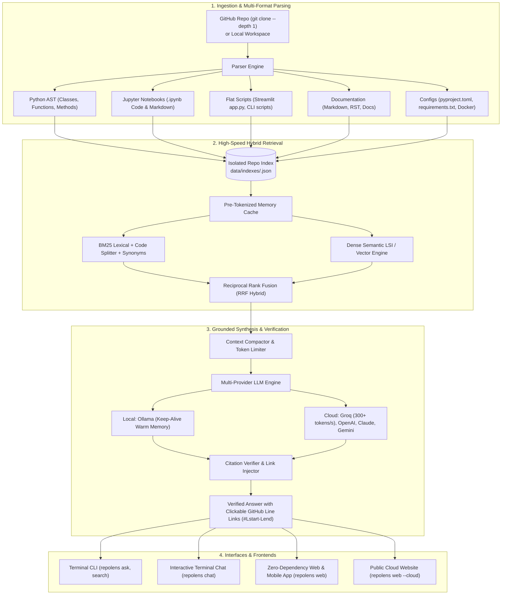

# RepoLens 🔍

[](https://www.python.org/)
[](tests/)
[](#architecture)
[](#overview)
[](LICENSE)
[](#deployment--cloud-hosting)

**RepoLens** is an intelligent, high-performance repository intelligence and Retrieval-Augmented Generation (RAG) assistant for GitHub and local codebases. It ingests codebases, parses structured symbols (classes, functions, methods, flat scripts) and Jupyter Notebooks with exact line tracking, performs code-aware hybrid search, and generates grounded, cited answers with direct GitHub source links.

Works seamlessly across terminal CLI, interactive chat, and a responsive zero-dependency Web & Mobile PWA dashboard.

---

## 🏗 Architecture



---

## ⚡ Highlights & Features

- **🚀 Lightning-Fast Answering**:
  - **Pre-tokenized in-memory record cache** makes search passes execute in `< 5ms`.
  - **Ollama Warm Keep-Alive**: Prevents model unloading from memory between queries.
  - **Ultra-Fast Cloud Inference via Groq**: Delivers answers in **0.3 to 0.8 seconds** (~300 tokens/sec).
  - **In-Memory Query Cache**: Repeated queries return instantaneously.
- **📚 Multi-Format Codebase Parsing**:
  - **Python AST**: Extracts classes, methods (e.g. `Flask.route`), functions, and docstrings.
  - **Jupyter Notebooks (`.ipynb`)**: Indexes code cells and markdown documentation cells.
  - **Flat Scripts**: Automatically chunks flat scripts (e.g., Streamlit `app.py`, migration scripts).
  - **Documentation & Configs**: Parses Markdown (`.md`), reStructuredText (`.rst`), `pyproject.toml`, `requirements.txt`, `Dockerfile`, etc.
- **🔍 Code-Aware Hybrid Retrieval**:
  - **Sub-identifier splitting**: Automatically splits `snake_case`, `camelCase`, and dot paths.
  - **Developer Synonym Expansions**: Resolves terms like *deployment* $\rightarrow$ *app, run, streamlit*, *pipeline* $\rightarrow$ *workflow, train, scaler*.
  - **Multi-Tier Fallbacks**: Automatically falls back to semantic search and repo entrypoints if exact tokens aren't found.
- **🔗 Verified Clickable Citations**:
  - Every answer verifies citations against retrieved line bounds.
  - Formats citations as clickable Markdown and terminal links jumping directly to GitHub source lines (e.g., `[app.py:1-74](https://github.com/user/repo/blob/main/app.py#L1-L74)`).
- **🌐 Dual-Mode Deployment (Local & Cloud)**:
  - Run completely offline and private via Ollama.
  - Switch to cloud LLMs (OpenAI, Anthropic, Gemini, Groq, DeepSeek) with a single command.
  - Launch an instant public HTTPS website (`repolens web --cloud`) or deploy 24/7 on Render or Docker.

---

## 🚀 Quickstart

### 1. Installation
Clone the repository and install requirements (Python 3.10+):
```bash
git clone https://github.com/wasimmos/repo-lens.git
cd repo-lens
pip install numpy
```

*(Optional: Install `repolens` CLI alias globally)*:
```bash
pip install -e .
```

### 2. Choose Your LLM Provider

#### Option A: Ultra-Fast Cloud (Groq, OpenAI, Gemini, etc.)
For near-instant answers (< 1 second):
```bash
# Groq (Free API keys available at groq.com - ~300 tokens/second!)
export GROQ_API_KEY="gsk_..."
repolens provider groq

# Or Google Gemini
export GEMINI_API_KEY="AIza..."
repolens provider gemini

# Or OpenAI
export OPENAI_API_KEY="sk-..."
repolens provider openai --model gpt-4o-mini
```

#### Option B: 100% Local & Private (Ollama)
```bash
ollama serve
ollama pull qwen2.5-coder:3b
repolens provider ollama
```

---

## 📖 Usage Guide

### 1. Ingest a Repository
Ingest from GitHub shorthand, full URL, or local path:
```bash
# GitHub shorthand
repolens ingest pallets/flask

# Full git repository URL
repolens ingest https://github.com/IMADGOD7/heart_disease_predictor.git

# Local repository folder
repolens ingest ./my-local-project
```

### 2. Ask Questions Directly
Ask questions without quoting or subcommands:
```bash
# Direct question
repolens "Where is the entry point defined?"

# Or using ask
repolens ask How does route registration work

# Target a specific repository or enable hybrid vector search
repolens ask "where is the deployment pipeline located" --repo heart_disease_predictor --hybrid
```

### 3. Interactive Chat with Slash Commands
Start an interactive terminal Q&A session:
```bash
repolens chat
```
Supported chat commands:
- `/use <repo>` — Switch active repository
- `/hybrid` — Toggle hybrid BM25 + dense vector search
- `/list` — View all indexed repositories
- `/exit` — Exit chat

### 4. Manage Repositories
```bash
# List all indexed repositories and see which is active
repolens list

# Switch the active repository (supports fuzzy matching)
repolens use heart_disease_predictor

# Delete a repository and its cached index files
repolens delete nonexistent_repo    # aliases: repolens rm, repolens remove
```

### 5. Web & Mobile App (Local & Cloud Website)

#### Instant Public Cloud URL (Share with Anyone Worldwide)
```bash
repolens web --cloud    # alias: repolens cloud
```
Generates a secure HTTPS public tunnel URL:
```text
  🌐 Public Cloud URL:  https://xxxx.lhr.life
  📱 Mobile Access:     Open on any phone worldwide on 4G/5G/Wi-Fi
  💻 Localhost URL:     http://localhost:8000
```

#### Local Web App
```bash
repolens web
```
Open [http://localhost:8000](http://localhost:8000) in your browser. Install it on your mobile device by choosing **"Add to Home Screen"** in iOS Safari or Android Chrome.

---

## 🛠 Command Reference

| Command | Aliases | Options | Description |
|---|---|---|---|
| `repolens <question>` | | | Ask question directly from terminal |
| `repolens ask <question>` | | `[--repo <id>] [--hybrid] [--provider <p>] [--model <m>]` | Single-shot grounded Q&A |
| `repolens chat` | `talk`, `interactive` | `[--repo <id>] [--hybrid]` | Interactive terminal chat |
| `repolens ingest <source>` | `clone`, `add` | `[--force] [--python-only]` | Ingest, parse, and index a codebase |
| `repolens list` | `ls`, `repos` | | List all indexed repositories |
| `repolens use <repo>` | `select`, `switch` | `<repo_id>` | Set active repository |
| `repolens delete <repo>` | `rm`, `remove` | `<repo_id>` | Delete repository and index |
| `repolens search <query>` | | `[--repo <id>] [--hybrid] [--top-k <k>]` | Code and doc passage search |
| `repolens web` | `ui`, `serve`, `app` | `[--cloud] [--port <p>] [--host <h>]` | Launch Web & Mobile App |
| `repolens cloud` | `share` | | Launch with public HTTPS cloud link |
| `repolens provider [name]` | `agent`, `llm` | `[--model <m>] [--api-key <k>] [--url <u>]` | Switch or configure LLM |
| `repolens model [name]` | | `[--provider <p>]` | View or switch active model |
| `repolens status` | | | System and provider status |

---

## 🌐 Supported LLM Providers

| Provider | Type | Speed | Default Model | Environment Variable |
|---|---|---|---|---|
| **Groq** | Cloud | ⚡ **Ultra-fast (~300 t/s)** | `llama-3.3-70b-versatile` | `GROQ_API_KEY` |
| **Ollama** | Local | 🔒 **Private / Offline** | `qwen2.5-coder:3b` | `OLLAMA_MODEL`, `OLLAMA_URL` |
| **OpenAI** | Cloud | ⚡ Fast | `gpt-4o-mini` | `OPENAI_API_KEY` |
| **Google Gemini** | Cloud | ⚡ Fast | `gemini-2.0-flash` | `GEMINI_API_KEY`, `GOOGLE_API_KEY` |
| **Anthropic** | Cloud | 🧠 Deep reasoning | `claude-3-5-sonnet-latest` | `ANTHROPIC_API_KEY` |
| **DeepSeek** | Cloud | ⚡ Fast & Cheap | `deepseek-chat` | `DEEPSEEK_API_KEY` |
| **OpenRouter** | Cloud | 🌐 Aggregated | `openai/gpt-4o-mini` | `OPENROUTER_API_KEY` |
| **Custom / LM Studio** | Local/Remote | ⚙️ Configurable | `local-model` | `CUSTOM_LLM_API_KEY` |

---

## ☁️ Deployment & Cloud Hosting

RepoLens comes with ready-to-deploy configurations for 100% free cloud hosting:

- **Render (`render.yaml`)**:
  Connect your GitHub repository to [Render](https://render.com). It automatically detects `render.yaml`, provisions a free web service, and assigns an SSL HTTPS domain (e.g., `https://repo-lens.onrender.com`).
- **Docker (`Dockerfile` & `docker-compose.yml`)**:
  ```bash
  docker compose up -d --build
  ```
- **Fly.io (`fly.toml`)**:
  ```bash
  fly launch
  ```

---

## 🧪 Testing

RepoLens includes a comprehensive test suite with 67 automated tests:
```bash
pytest
```

Tests cover:
- Repository cloning, caching, and validation
- Multi-format AST, script, notebook (`.ipynb`), and documentation parsing
- BM25 sub-tokenization, synonym expansions, and LSI semantic vector search
- Multi-provider LLM integrations with HTTP mock tests
- Citation validation with GitHub line range links
- REST API endpoints and CLI UX commands

---

## 📄 License

MIT License. Free and open source.
